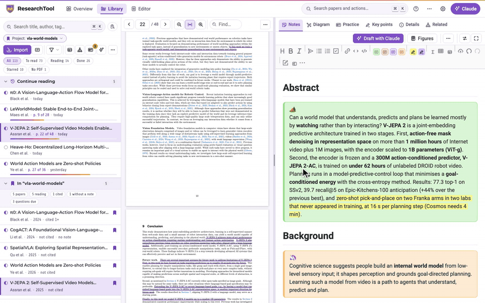
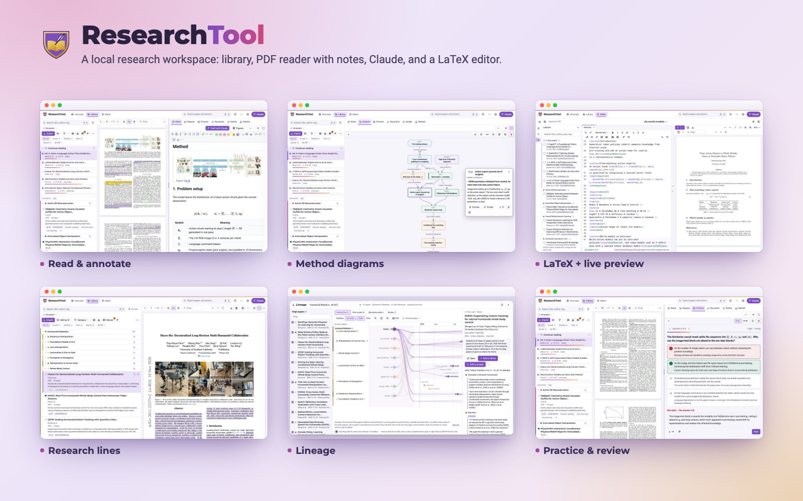
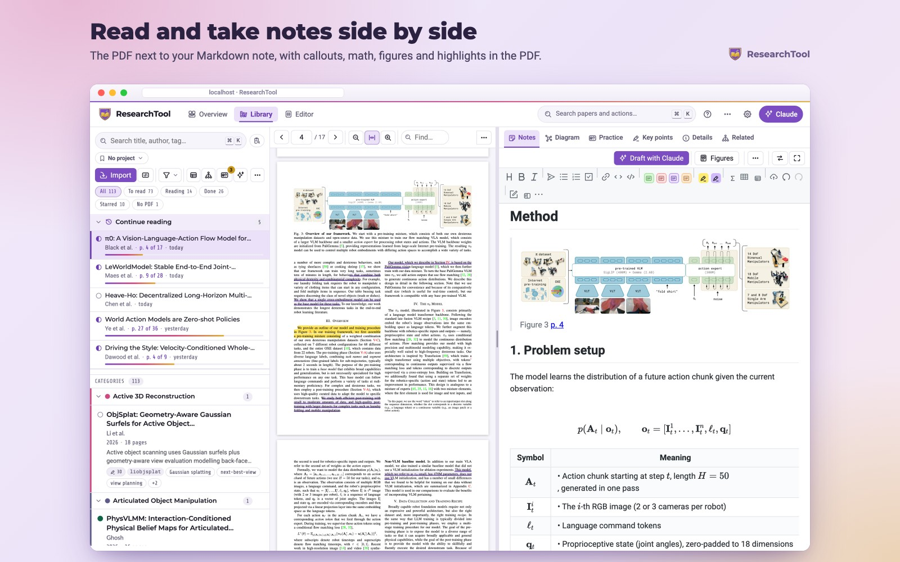
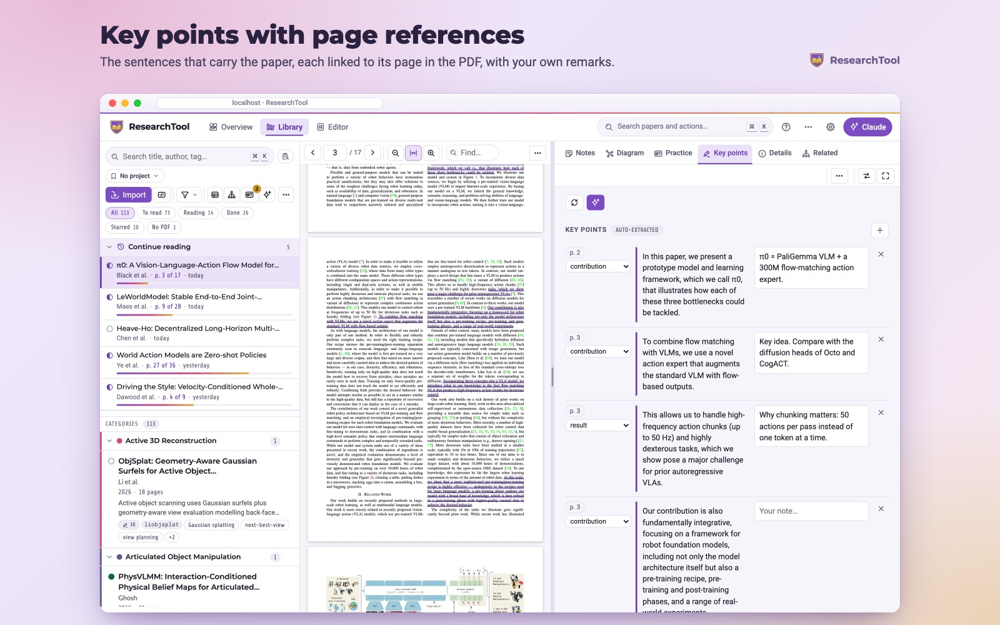
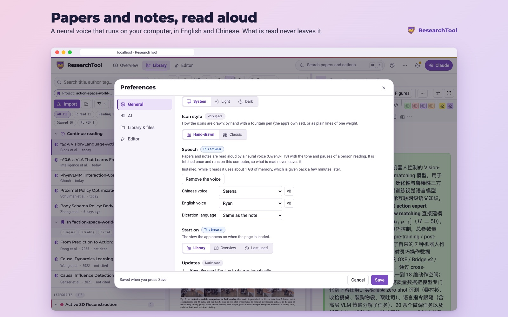
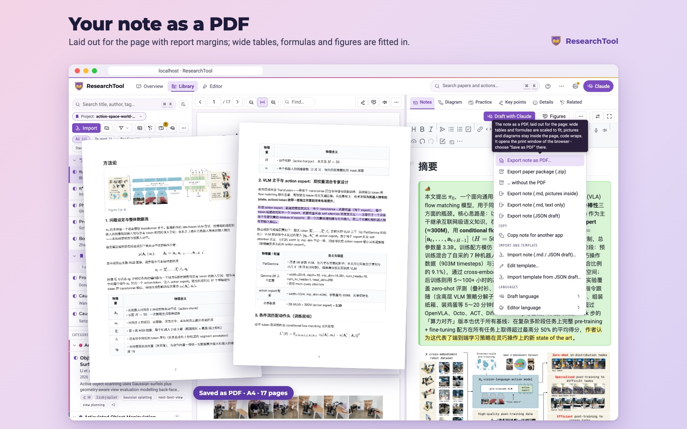
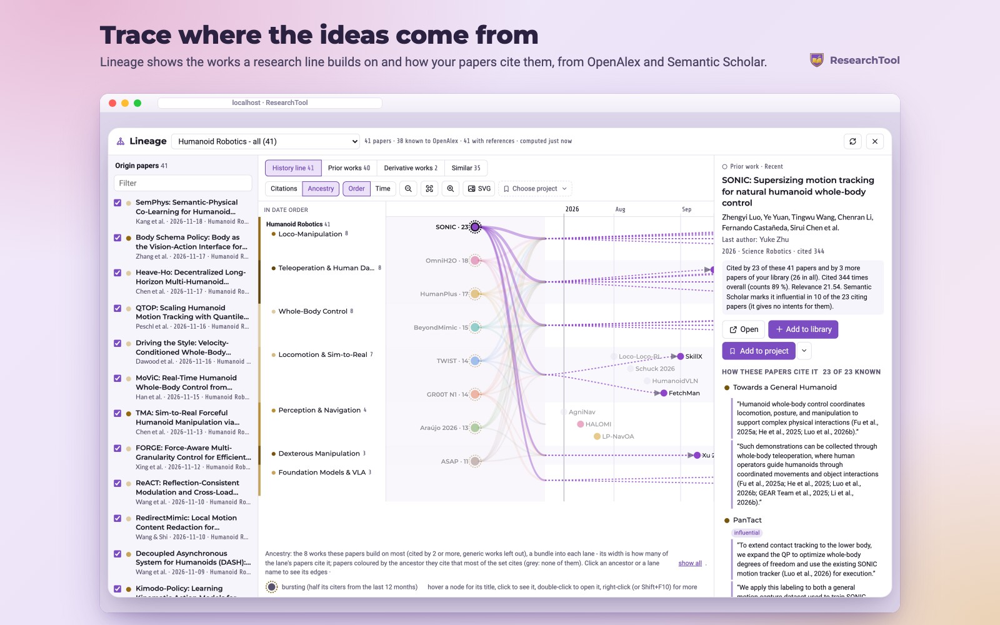
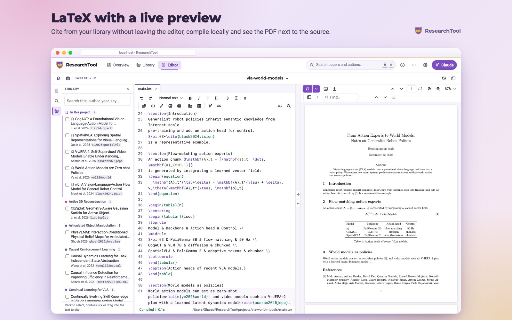
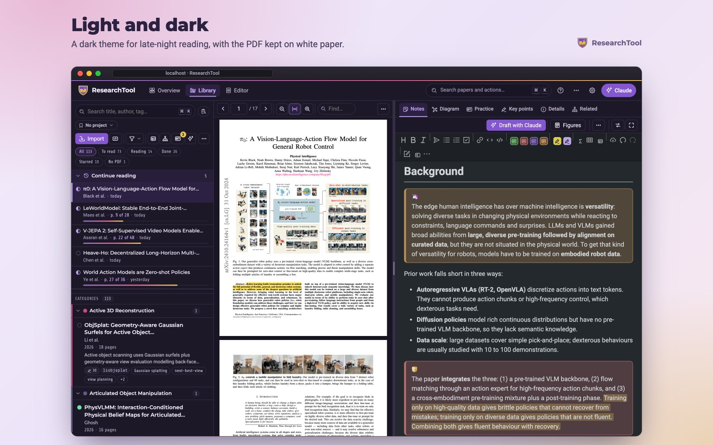

<p align="center">
  
</p>

<h1 align="center">ResearchTool</h1>

<p align="center"><b>Your papers, notes and LaTeX in one local workspace.</b></p>

<p align="center">
  <a href="https://github.com/purple-ginseng/ResearchTool/actions/workflows/ci.yml"></a>
  <a href="LICENSE"></a>
  <a href="https://purple-ginseng.github.io/ResearchTool/"></a>
</p>

<p align="center">
  
</p>

ResearchTool is a local research workspace for one person, run as a small Node server and used in the browser. It
keeps a reference library with a PDF reader, highlights and Markdown reading notes, helps you see how papers relate
to each other, and has an Overleaf-style LaTeX editor with live PDF preview, version history and optional Overleaf
sync. All data stays in a plain folder on your computer, and the AI features are optional.

## Why

Reading for a research project usually spreads over a reference manager, a PDF viewer, a notes app and a LaTeX
editor, and the links between them live in your head. ResearchTool keeps them in one place: the paper, your note on
it, the sentences that matter with their page numbers, how it relates to the papers around it, and the draft that
cites it. It runs on your own computer, needs no account and no `npm install`, and keeps everything as ordinary
files - PDFs, Markdown, LaTeX and JSON - that you can back up, read or edit without the app.

<p align="center">
  
</p>

## Features

Each part is described in full in the [user guide](docs/guide.md).

**Library**

- A start page (the Overview) with counts, quick actions, questions due for review, papers without a brief, continue reading,
  reading stats, recently added papers and notes, research lines, projects and workspace health (backups, trash, tools found).
- Import PDFs, folders and `.bib` files, or paste arXiv ids, DOIs, OpenReview and publisher links.
- Duplicate detection, reading status, stars, tags, categories ("research lines") with sub-lines, full-text search
  over PDFs, notes and key points (Chinese included).
- Organize the library from a Markdown reading list or a `.bib` file; papers can belong to LaTeX projects.
- "Check venues" verifies where a paper was published (Crossref, DBLP, OpenAlex, Semantic Scholar, PMLR, arXiv).
- Trash with undo for everything, automatic copies of the library and daily snapshots of the workspace.

**Reader and notes**

- PDF reader (pdf.js) with search, table of contents, clickable internal links, colour highlights, a snapshot tool
  and page links from the note back into the PDF.
- Markdown notes (Vditor) with callouts, KaTeX formulas, pictures and videos, version history, and export as `.md`,
  a self-contained `.md` or a "paper package" `.zip`.
- **Export note as PDF**: the note laid out for A4 or Letter, with wide tables and formulas scaled to fit.
- Key points with page references, and the figures and tables of a PDF cut out without AI.
- **Read aloud**: papers and notes can be read aloud by a neural voice that runs on your computer (an optional
  download, about 805 MB), and notes can be dictated.

**Explore**

- Lineage: the works a research line builds on and how your papers cite them, from OpenAlex and Semantic Scholar.
- The Related tab lists the references and citing papers of one paper, each added with one click.
- With AI: a method diagram of a paper, practice questions that come back for review, and comparison tables
  across up to 15 papers.

**Editor**

- LaTeX projects (local, a folder on disk, or an Overleaf clone): file tree, tabs, autosave, autocomplete, `\cite`
  and `\ref` pickers fed by your library, spelling and writing checks, word counts and page limits.
- Compile with latexmk (pdfLaTeX / XeLaTeX / LuaLaTeX), clickable log, SyncTeX in both directions.
- `references.bib` generated from the library with only the entries the project cites.
- Optional Overleaf sync through Overleaf's Git integration (pull, push, conflict choice).

**AI (optional)**

- The AI features run through an AI command-line tool installed on your computer and signed in with your own account:
  Claude Code (`claude`) by default, or OpenAI Codex, xAI Grok Build or Google Antigravity (see [AI providers](docs/ai.md#ai-providers)).
- ResearchTool does not call any AI API itself, holds no API key and never asks for a password.
- Each paper and each project has its own conversations, kept in the workspace; the History button of the panel
  lists them, to read again or go on with.
- What the AI writes is a draft: check it against the paper, as you would a colleague's notes.
- Without an AI CLI the app works fully as a library, reader, note-taking tool and LaTeX editor.

## Screenshots

*Screenshots use a demo copy of the author's library.* The captions describe what each feature does; the notes,
diagrams and questions shown in them are examples, not a promise of what Claude will write for your papers.

<table>
<tr><th colspan="2">Overview and Library</th></tr>
<tr>
<td width="50%" valign="top"><br><b>Your research at a glance.</b> Continue reading, questions due for review and reading stats on one start page.</td>
<td width="50%" valign="top"><br><b>A library organized by research lines.</b> Categories nest into research lines; filter by reading status with one click, search by title, author or tag.</td>
</tr>
<tr><th colspan="2">Reader, notes and chat</th></tr>
<tr>
<td valign="top"><br><b>Read and take notes side by side.</b> The PDF next to your Markdown note, with callouts, math, figures and highlights in the PDF.</td>
<td valign="top"><br><b>Key points with page references.</b> The sentences that carry the paper, each linked to its page in the PDF, with your own remarks.</td>
</tr>
<tr>
<td valign="top"><br><b>Every figure, cut out of the PDF.</b> Figures and tables are found from the PDF layout, without Claude. Click one to put it into the note. A links finder collects the project page, code and data a paper names.</td>
<td valign="top"><br><b>Papers and notes, read aloud.</b> A neural voice that runs on your computer, in English and Chinese. What is read never leaves it.</td>
</tr>
<tr>
<td valign="top"><br><b>Your note as a PDF.</b> Laid out for the page with report margins; wide tables, formulas and figures are fitted in.</td>
<td valign="top"><br><b>Every conversation, kept with its paper.</b> The History button lists the earlier chats about this paper, and those about your other papers.</td>
</tr>
<tr><th colspan="2">Explore</th></tr>
<tr>
<td valign="top"><br><b>Trace where the ideas come from.</b> Lineage shows the works a research line builds on and how your papers cite them, from OpenAlex and Semantic Scholar. The Related tab lists the references and citing papers of one paper, each added with one click.</td>
<td valign="top"><br><b>The method as a diagram</b> (with Claude). Claude draws the paper as a pipeline. Point at a box to read what it means, with page references.</td>
</tr>
<tr>
<td valign="top"><br><b>Check what you understood</b> (with Claude). Practice questions explain every option, right or wrong; answered questions come back for review. Explanations and translations of a passage cite their pages too.</td>
<td valign="top"><br><b>Ask across papers</b> (with Claude). Pick papers (up to 15), name the columns and let Claude fill a comparison table, or ask one question of all of them.</td>
</tr>
<tr><th colspan="2">Editor</th></tr>
<tr>
<td valign="top"><br><b>LaTeX with a live preview.</b> Cite from your library without leaving the editor, compile locally and see the PDF next to the source.</td>
<td valign="top"><br><b>Every version, every change.</b> Saved and autosaved versions of each file, with a line-by-line diff you can restore from.</td>
</tr>
<tr><th colspan="2">Made to be comfortable</th></tr>
<tr>
<td valign="top"><br><b>Everything one keystroke away.</b> Press Cmd/Ctrl+K to find any paper, view or action, with their keyboard shortcuts.</td>
<td valign="top"><br><b>A guided tour of every feature.</b> Eight chapters walk you through the app, pointing at each control where it lives.</td>
</tr>
<tr>
<td valign="top"><br><b>English and 中文.</b> The whole interface switches between English and Simplified Chinese; papers stay in their own language.</td>
<td valign="top"><br><b>Light and dark.</b> A dark theme for late-night reading, with the PDF kept on white paper.</td>
</tr>
</table>

## Demo videos

Two walkthroughs from the Overview to the Editor, one in English (about 9 minutes) and one in 中文 (about 11
minutes). Watch them on the [project page](https://purple-ginseng.github.io/ResearchTool/#demo); both files are also
attached to the [v0.1.0 release](https://github.com/purple-ginseng/ResearchTool/releases/tag/v0.1.0). They were
recorded with the same demo copy of the author's library as the screenshots.

## Quick start

You need [Node.js](https://nodejs.org/) 18 or newer and git. There is no `npm install` and no build step.
The commands are the same on macOS, Linux and Windows 10 / 11:

```bash
git clone https://github.com/purple-ginseng/ResearchTool.git
cd ResearchTool
node server.js
```

Then open http://localhost:4790. Your data goes to `./workspace` (created on the first start). A newer version is a `git pull` in that folder, followed by a restart; the app can also update itself (off unless you tick it).
Another data folder or port, updating and the notes for each system are in [docs/install.md](docs/install.md).

## Requirements

Only Node 18+ is needed to start. The other tools are optional; anything missing only disables its own feature,
and the app tells you what was not found. The full table and how to install each tool are in
[docs/install.md](docs/install.md#requirements).

- `pdftotext`, `pdfinfo`, `pdftoppm` (poppler): PDF import, sentence extraction, figures and tables.
- `latexmk` + a TeX distribution (MacTeX / TeX Live / MiKTeX): compiling.
- `git`: Overleaf sync. `unzip`: importing a project from a .zip.
- One AI CLI - `claude` (default), or `codex`, `grok` or `agy` (Antigravity): the AI features.

## Privacy

The server listens on 127.0.0.1 only. Your PDFs, notes, highlights and projects stay in the workspace folder.
There is no account, no telemetry and no analytics; fonts and scripts are served from `public/vendor`, never from a CDN.
Online lookups happen only when you use a feature that needs them, and send only the arXiv id, DOI, OpenReview
id, link or title of a paper ("Check venues" also sends Crossref the first author's surname with a title search).
Every case, and each site that is contacted, is listed in [docs/privacy.md](docs/privacy.md).

## Documentation

| File | What is in it |
| --- | --- |
| [docs/install.md](docs/install.md) | Quick start in detail, updating, requirements, notes for macOS, Linux and Windows |
| [docs/guide.md](docs/guide.md) | The keys, the Overview, the Library (reader, notes, read aloud, export as PDF, Explore), the Editor, connecting Overleaf, language, guided tour |
| [docs/ai.md](docs/ai.md) | How the AI features work, using Claude Code, the other AI providers, chat history |
| [docs/privacy.md](docs/privacy.md) | Privacy, what goes online, where things live, trash and backup |
| [docs/troubleshooting.md](docs/troubleshooting.md) | Reporting a bug, and what to do when AI features, PDF tools or updates fail |
| [docs/configuration.md](docs/configuration.md) | Environment variables |
| [docs/preferences.md](docs/preferences.md) | For contributors: how the display-language (translation) layer works |
| [ARCHITECTURE.md](ARCHITECTURE.md) | The code layout |
| [CONTRIBUTING.md](CONTRIBUTING.md) | How to contribute |
| [SECURITY.md](SECURITY.md) | Reporting a security problem |

## 中文简介

ResearchTool 是一个在自己电脑上运行的科研工作区：文献库、PDF 阅读器（高亮、目录、站内链接）、Markdown 阅读笔记、
带页码的论文要点、从 PDF 中自动裁出的图表、论文之间的引用脉络，以及带实时 PDF 预览、版本历史和可选 Overleaf 同步的
LaTeX 编辑器。所有数据都保存在一个普通文件夹里，没有账号、没有遥测。AI 功能是可选的，通过你本机的 AI 命令行工具运行，用的是你自己的账号。界面支持英文和简体中文（偏好设置 › 通用 › 显示语言）。

快速开始：安装 Node 18 或更新版本，然后 `git clone https://github.com/purple-ginseng/ResearchTool.git`、
`cd ResearchTool`、`node server.js`，再打开 http://localhost:4790 。项目主页（含中文演示视频）：
https://purple-ginseng.github.io/ResearchTool/ ，中文项目主页：https://purple-ginseng.github.io/ResearchTool/zh/

<details>
<summary>AI 工具、更新和图标</summary>

AI 工具默认是 Claude Code（`claude`），也可以在偏好设置 › AI 中换成 OpenAI Codex、xAI Grok Build 或 Google Antigravity
（`agy`，个人 Google 账号可用）。Claude Code 可以修改文件；Codex 在偏好设置 › AI 里勾选「Let Codex edit files」后也可以（默认关闭，只能改打开的 LaTeX 项目和阅读笔记，改动记入项目历史、可以恢复）；Grok Build 和 Antigravity 在面板里是只读的；Grok Build 不支持 Windows。

更新：在偏好设置 › 通用 里勾选「Keep ResearchTool up to date automatically」后，程序会自动从官方仓库拉取新版本（默认关闭，只做快进更新，不会动你的工作区），更新后按提示重启即可。图标默认是为本项目手绘的一套，可在同一页切换回经典线条图标。

</details>

## Project status

This is a personal project, shared as it is, with no release schedule and no support promise. Issues and pull
requests are welcome; see [CONTRIBUTING.md](CONTRIBUTING.md). For security problems see [SECURITY.md](SECURITY.md).

## Licence

The code is released under the [MIT License](LICENSE). The bundled third-party libraries and fonts keep their own
licences, listed in [THIRD_PARTY_LICENSES.md](THIRD_PARTY_LICENSES.md) and [NOTICE](NOTICE). The crest and app
icons are covered by `public/brand/LICENSE-NOTE.txt`.
