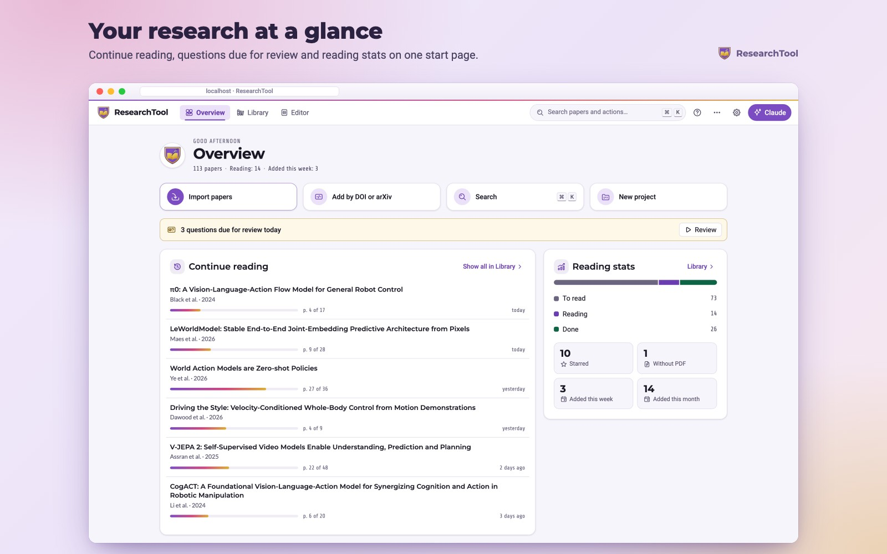
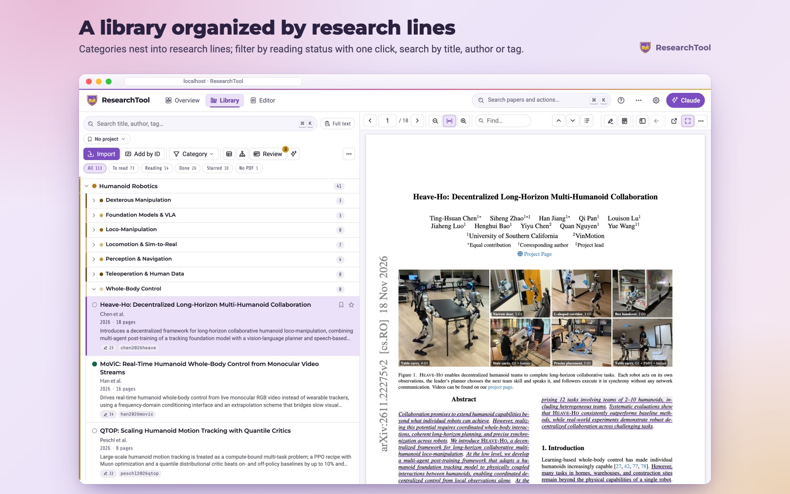
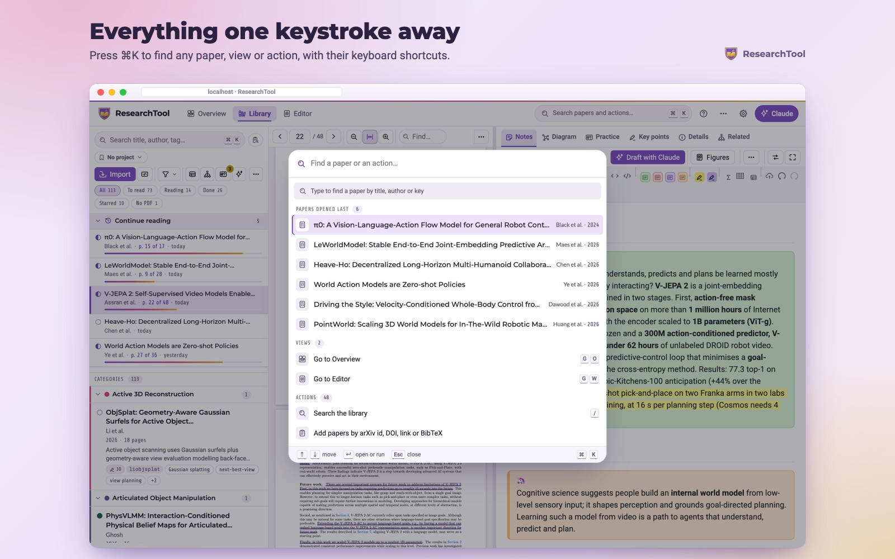
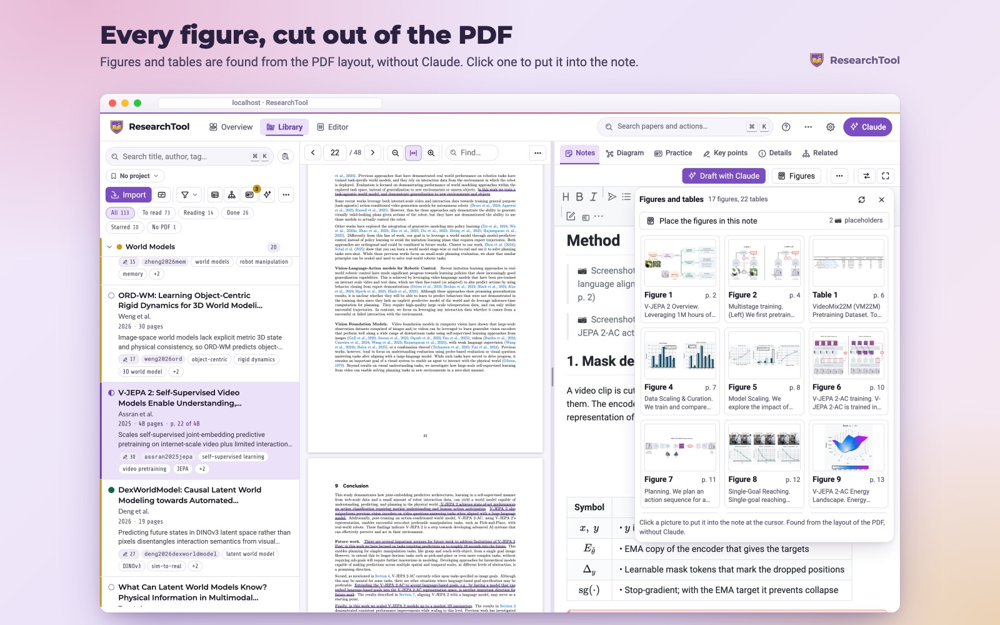
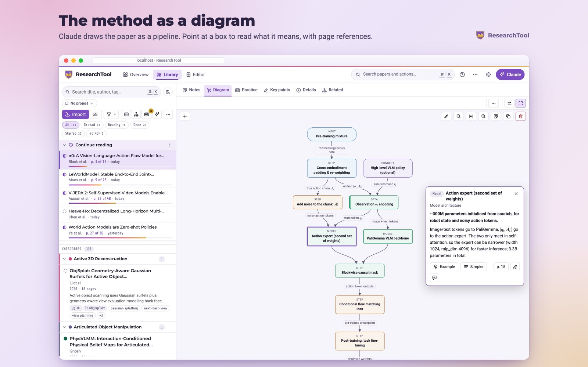
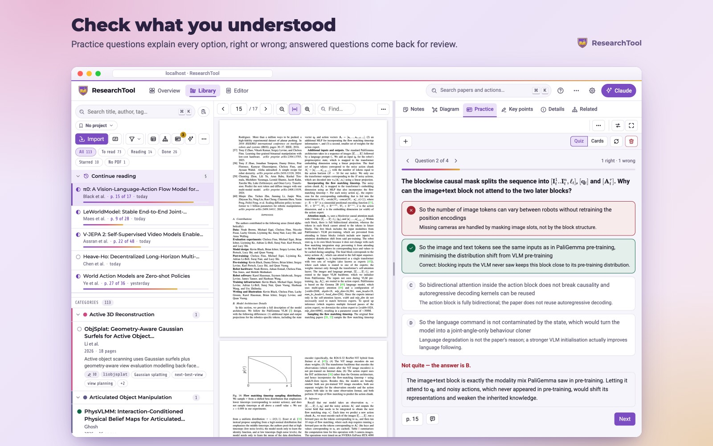
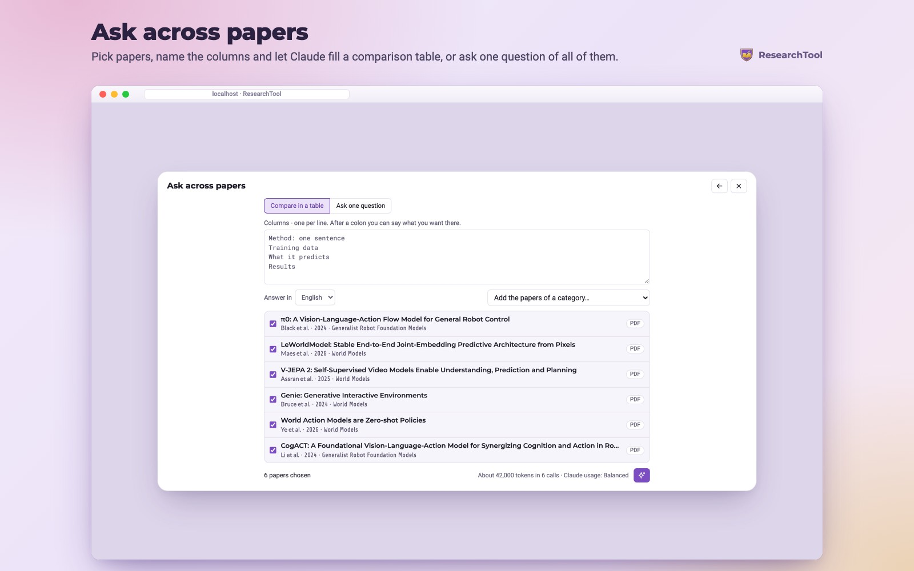
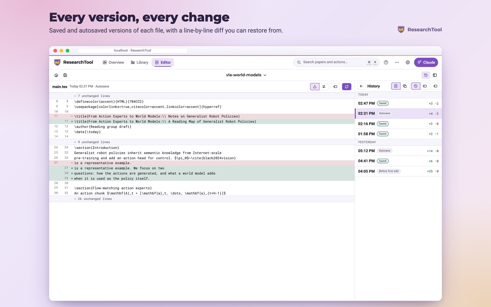
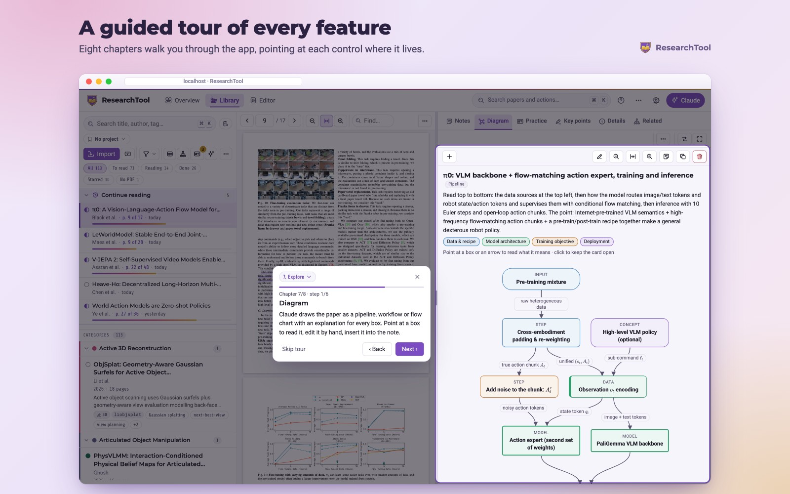
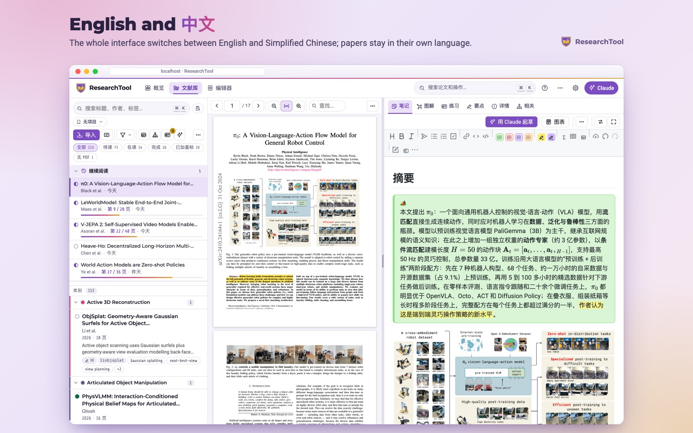

<p align="center">
  
</p>

<h1 align="center">ResearchTool</h1>

<p align="center"><b>Your papers, notes and LaTeX in one local workspace.</b></p>

<p align="center">
  <a href="https://github.com/purple-ginseng/ResearchTool/actions/workflows/ci.yml"></a>
  <a href="LICENSE"></a>
  <a href="https://purple-ginseng.github.io/ResearchTool/"></a>
</p>

<p align="center">
  
</p>

ResearchTool is a local research workspace for one person, run as a small Node server and used in the browser. It
keeps a reference library with a PDF reader, highlights and Markdown reading notes, helps you see how papers relate
to each other, and has an Overleaf-style LaTeX editor with live PDF preview, version history and optional Overleaf
sync. All data stays in a plain folder on your computer. The AI features are optional and run through an AI command-line tool
installed on your computer and signed in with your own account: Claude Code (`claude`) by default, or OpenAI Codex,
xAI Grok Build or Google Antigravity (see [AI providers](#ai-providers)).

## Why

Reading for a research project usually spreads over a reference manager, a PDF viewer, a notes app and a LaTeX
editor, and the links between them live in your head. ResearchTool keeps them in one place: the paper, your note on
it, the sentences that matter with their page numbers, how it relates to the papers around it, and the draft that
cites it. It runs on your own computer, needs no account and no `npm install`, and keeps everything as ordinary
files - PDFs, Markdown, LaTeX and JSON - that you can back up, read or edit without the app.

<p align="center">
  
</p>

## 中文简介

ResearchTool 是一个在自己电脑上运行的科研工作区：文献库、PDF 阅读器（高亮、目录、站内链接）、Markdown 阅读笔记、
带页码的论文要点、从 PDF 中自动裁出的图表、论文之间的引用脉络，以及带实时 PDF 预览、版本历史和可选 Overleaf 同步的
LaTeX 编辑器。所有数据都保存在一个普通文件夹里，没有账号、没有遥测。AI 功能是可选的，通过你本机的 AI 命令行工具运行，用的是你自己的账号：
默认是 Claude Code（`claude`），也可以在偏好设置 › AI 中换成 OpenAI Codex、xAI Grok Build 或 Google Antigravity
（`agy`，个人 Google 账号可用）。只有 Claude Code 可以修改文件，其他工具在面板里是只读的；Grok Build 不支持 Windows。界面支持英文和简体中文（偏好设置 › 通用 › 显示语言）。

快速开始：安装 Node 18 或更新版本，然后 `git clone https://github.com/purple-ginseng/ResearchTool.git`、
`cd ResearchTool`、`node server.js`，再打开 http://localhost:4790 。项目主页（含中文演示视频）：
https://purple-ginseng.github.io/ResearchTool/

## Features

*Screenshots use a demo copy of the author's library.* The captions describe what each feature does; the notes,
diagrams and questions shown in them are examples, not a promise of what Claude will write for your papers.

### Overview



**Your research at a glance.** Continue reading, questions due for review and reading stats on one start page.

- A start page with counts, quick actions, questions due for review, papers without a brief, continue reading,
  reading stats, recently added papers and notes, research lines, projects and workspace health (backups, trash,
  tools found).

### Library



**A library organized by research lines.** Categories nest into research lines; filter by reading status with one
click, search by title, author or tag.

- Import PDFs, folders and `.bib` files, or paste arXiv ids, DOIs, OpenReview and publisher links.
- Duplicate detection, reading status, stars, tags, categories ("research lines") with sub-lines, full-text search
  over PDFs, notes and key points (Chinese included).
- Organize the library from a Markdown reading list or a `.bib` file; papers can belong to LaTeX projects.
- "Check venues" verifies where a paper was published (Crossref, DBLP, OpenAlex, Semantic Scholar, PMLR, arXiv).
- Trash with undo for everything, automatic copies of the library and daily snapshots of the workspace.



**Everything one keystroke away.** Press Cmd/Ctrl+K to find any paper, view or action, with their keyboard
shortcuts.

### Reader and notes


**Read and take notes side by side.** The PDF next to your Markdown note, with callouts, math, figures and
highlights in the PDF.

- PDF reader (pdf.js) with search, table of contents, clickable internal links, colour highlights, a snapshot tool
  and page links from the note back into the PDF.
- Markdown notes (Vditor) with callouts, KaTeX formulas, pictures and videos, version history, and export as `.md`,
  a self-contained `.md` or a "paper package" `.zip`.


**Key points with page references.** The sentences that carry the paper, each linked to its page in the PDF, with
your own remarks.



**Every figure, cut out of the PDF.** Figures and tables are found from the PDF layout, without Claude. Click one to
put it into the note. A links finder collects the project page, code and data a paper names.

### Explore


**Trace where the ideas come from.** Lineage shows the works a research line builds on and how your papers cite
them, from OpenAlex and Semantic Scholar. The Related tab lists the references and citing papers of one paper, each
added with one click.



**The method as a diagram** (with Claude). Claude draws the paper as a pipeline. Point at a box to read what it
means, with page references.



**Check what you understood** (with Claude). Practice questions explain every option, right or wrong; answered
questions come back for review. Explanations and translations of a passage cite their pages too.



**Ask across papers** (with Claude). Pick papers (up to 15), name the columns and let Claude fill a comparison
table, or ask one question of all of them.

### Editor


**LaTeX with a live preview.** Cite from your library without leaving the editor, compile locally and see the PDF
next to the source.

- LaTeX projects (local, a folder on disk, or an Overleaf clone): file tree, tabs, autosave, autocomplete, `\cite`
  and `\ref` pickers fed by your library, spelling and writing checks, word counts and page limits.
- Compile with latexmk (pdfLaTeX / XeLaTeX / LuaLaTeX), clickable log, SyncTeX in both directions.
- `references.bib` generated from the library with only the entries the project cites.
- Optional Overleaf sync through Overleaf's Git integration (pull, push, conflict choice).



**Every version, every change.** Saved and autosaved versions of each file, with a line-by-line diff you can
restore from.

### Made to be comfortable



**A guided tour of every feature.** Eight chapters walk you through the app, pointing at each control where it lives.



**English and 中文.** The whole interface switches between English and Simplified Chinese; papers stay in their own
language.


**Light and dark.** A dark theme for late-night reading, with the PDF kept on white paper.

## Demo videos

Two walkthroughs from the Overview to the Editor, one in English (about 9 minutes) and one in 中文 (about 11
minutes). Watch them on the [project page](https://purple-ginseng.github.io/ResearchTool/#demo); both files are also
attached to the [v0.1.0 release](https://github.com/purple-ginseng/ResearchTool/releases/tag/v0.1.0). They were
recorded with the same demo copy of the author's library as the screenshots.

## Quick start

You need [Node.js](https://nodejs.org/) 18 or newer and git. There is no `npm install` and no build step: the
server uses only Node's standard library, and the browser libraries (CodeMirror, pdf.js, Vditor and its renderers,
the fonts) are bundled in `public/vendor`, so the app works offline.

**macOS and Linux** (bash, zsh):

```bash
git clone https://github.com/purple-ginseng/ResearchTool.git
cd ResearchTool
node server.js
```

**Windows 10 / 11** (PowerShell):

```powershell
git clone https://github.com/purple-ginseng/ResearchTool.git
cd ResearchTool
node server.js
```

Then open http://localhost:4790. Your data goes to `./workspace` (created on the first start). To keep it elsewhere,
or to run a second copy on another port:

```bash
RT_WORKSPACE=~/ResearchTool-data PORT=4791 node server.js                 # macOS, Linux
```

```powershell
$env:RT_WORKSPACE="$HOME\ResearchTool-data"; $env:PORT=4791; node server.js   # Windows PowerShell
```

(In the Windows command prompt: `set RT_WORKSPACE=%USERPROFILE%\ResearchTool-data` and `set PORT=4791`, then
`node server.js`.) The tools below add PDF import, compiling and the other features; how to install them on each
system is in "macOS, Linux and Windows".

## Requirements

| Tool | Needed for |
| --- | --- |
| Node 18+ (CI runs Node 18, 20 and 24) | the server |
| `pdftotext`, `pdfinfo` (poppler) | PDF import, sentence extraction |
| `pdftotext`, `pdftoppm` (poppler) | finding the figures and tables of a PDF and cutting them out (optional: without them the Figures list says so and everything else works) |
| `latexmk` + a TeX distribution (MacTeX / TeX Live / MiKTeX) | compiling; `synctex` for jumping between source and PDF, `texcount` for the word counts |
| `unzip` (or the `tar` built into Windows 10+ and macOS) | importing a project from a .zip |
| `git` | Overleaf sync |
| one AI CLI: `claude` (default), or `codex`, `grok` or `agy` (Antigravity) - see [AI providers](#ai-providers) | the Claude panel, automatic grouping and briefs, "Extract with Claude", "Generate first draft", diagrams, quizzes, explanations and translations, comparison tables, rewriting a selection and drafting related work in LaTeX |
| A system word list (`/usr/share/dict/words` or similar) | spell check in the Editor (macOS ships one; on Debian / Ubuntu install `wamerican`; Windows has none, so there this check is off) |
| Internet access (optional) | adding a paper by arXiv id / DOI / link, the Related tab, Lineage, "Check metadata", "Check venues" and "Find links" (see Privacy) |

Anything missing only disables its own feature; the app tells you what was not found (the Overview's "Workspace
health" card lists the tools).

## macOS, Linux and Windows

ResearchTool runs on macOS, Linux (tested on Ubuntu) and Windows 10 / 11. The unit tests, a translation check and a
smoke test of the real server run on Ubuntu, macOS and Windows for every push to `main` and every pull request
([`.github/workflows/ci.yml`](.github/workflows/ci.yml)); the badge at the top shows the latest result. The server
starts every tool directly, never through a shell.

- **macOS**: `brew install poppler`; MacTeX (or BasicTeX + `latexmk`); git comes with the Xcode command line tools
  (`xcode-select --install`). Spelling uses the system dictionary.
- **Ubuntu / Debian**: `sudo apt install poppler-utils latexmk texlive-latex-extra unzip git`; for spelling also a
  word list (`sudo apt install wamerican`, which gives `/usr/share/dict/words`). The native folder chooser of macOS is
  replaced by the in-page folder browser.
- **Windows**:
  - poppler: `scoop install poppler`, `choco install poppler` or `conda install -c conda-forge poppler`. The scoop
    and Chocolatey folders are added to the server's PATH by itself; otherwise put poppler's `bin` folder on PATH.
  - TeX: TeX Live (it brings its own Perl) or MiKTeX. MiKTeX's `latexmk.exe` and `texcount.exe` are Perl scripts and
    need a Perl installed separately (for example Strawberry Perl). Switch MiKTeX's "install missing packages on the
    fly" to *Yes* or *No*: when it is set to *Ask*, a compile waits for an answer nobody sees and stops after 180 s.
  - Git for Windows (https://git-scm.com/download/win), for Overleaf sync; its Git Bash runs the Overleaf login
    script. The native `claude` CLI on Windows also needs Git for Windows.
  - The `claude` CLI: the native installer (`claude.exe`) or `npm install -g @anthropic-ai/claude-code` both work.
    Of the `.cmd` files only a standard npm shim is used (its script is run with node); other `.cmd` / `.bat` files
    are never run, because only `cmd.exe` could run them.
  - Of the other AI CLIs, Codex and Antigravity can be used on Windows; Grok Build cannot, because its read-only
    sandbox exists only on macOS and Linux (see [AI providers](#ai-providers)).
  - A .zip is unpacked with the `tar.exe` built into Windows 10+ when there is no `unzip`.
  - The spelling check is off (Windows has no system word list); the other writing checks work.
  - The folder browser starts in your home folder; go up past `C:\` to "This PC" to reach other drives. The native
    macOS folder chooser is replaced by that browser.

## AI integration (optional)

ResearchTool does not call any AI API itself, holds no API key and never asks for a password. Every AI feature runs
one AI command-line tool installed on your own computer as a child process, signed in with your own account:
Claude Code (`claude`, the default; `claude auth login`, started from the person button in the Claude panel), or -
chosen in Preferences › AI - OpenAI Codex (`codex`), xAI Grok Build (`grok`) or Google Antigravity (`agy`). What that
CLI sends to its provider (Anthropic, OpenAI, xAI or Google), and under which terms, is between you and that account;
ResearchTool sends nothing to any other AI service. Gemini CLI is not offered (see [AI providers](#ai-providers)).

- Feature calls (grouping, briefs, key points, note drafts, diagrams, quizzes, explanations, comparison tables,
  rewrites, related-work drafts) run the CLI non-interactively with no tools, or with reading only where a feature
  must read a PDF or a picture. Each prompt carries the material of that feature (for example the brief, note, key
  points and the matching PDF passages of each paper in a comparison table, not the whole PDF); a token estimate is
  shown before the larger jobs.
- The Claude panel runs a Claude Code session inside your workspace folder with file tools only. With Codex, Grok
  Build or Antigravity the panel is a read-only chat: only Claude Code edits files.
- Only Claude reads the pages of a PDF itself; the other CLIs get the text extracted from it, so formulas and figures
  in a draft can be weaker. Grok Build does not work with ResearchTool on Windows. How Codex, Grok Build and
  Antigravity are kept read-only and how their output is read follow their published docs and are not yet confirmed
  by real runs with every account type (details under AI providers).
- Apart from filing newly imported papers into categories with a short brief (on by default; switch it off in
  "Group with Claude"), the AI is called only when you use an AI feature.
- Settings shows the calls, tokens and time used per feature over the last 7 days, for every provider.
- What the AI writes is a draft: check it against the paper, as you would a colleague's notes.

Without an AI CLI the app works fully as a library, reader, note-taking tool and LaTeX editor. If something goes
wrong, Help › **Copy diagnostics** gives a redacted text block for a bug report (see [Troubleshooting](#troubleshooting)).

## Privacy

- The server listens on 127.0.0.1 only and refuses requests whose Host or Origin is not this local address, so other
  machines and other web sites cannot reach it.
- Your PDFs, notes, highlights and projects stay in the workspace folder. There is no account, no telemetry and no
  analytics; fonts and scripts are served from `public/vendor`, never from a CDN.
- Online lookups happen only when you use a feature that needs them, and send only the arXiv id, DOI, OpenReview
  id, link or title of a paper ("Check venues" also sends Crossref the first author's surname with a title search):
  arxiv.org / export.arxiv.org, doi.org, api.crossref.org, api.openalex.org, api.semanticscholar.org, dblp.org,
  openreview.net / api2.openreview.net / api.openreview.net, proceedings.mlr.press and huggingface.co (arXiv id only).
  Answers are cached in `workspace/cache`.
- Adding a paper by DOI downloads its PDF from arXiv or, when OpenAlex names an open-access copy elsewhere, from that
  publisher or repository site (public https addresses only), so that site sees a request from your computer.
- "Find links" checks that the project and code links a paper names still answer, and reads that project page
  once, so those sites see a request from your computer.
- Overleaf sync talks to git.overleaf.com through your own `git`; the token stays in git's credential helper.
- AI features: see "AI integration" above.

## Language

The interface is available in English and Chinese: Preferences › General › Display language (English / 中文).
Your papers, notes and Claude's answers are never translated by this switch. The language of Claude's first drafts
and of category names has its own settings.

## Guided tour

Help (the **?** button) › "Take the tour" walks through the whole app in 8 chapters (Overview, Header, Library,
Reader, Notes, Claude panel, Explore, Editor), switching views by itself; → / ← move, Esc leaves. "Tour of this
screen" starts at the chapter of the current view. The **?** button also opens a written guide to the app.

## Project status

This is a personal project, shared as it is, with no release schedule and no support promise. Issues and pull
requests are welcome; see [CONTRIBUTING.md](CONTRIBUTING.md). For security problems see [SECURITY.md](SECURITY.md).

## Licence

The code is released under the [MIT License](LICENSE). The bundled third-party libraries and fonts keep their own
licences, listed in [THIRD_PARTY_LICENSES.md](THIRD_PARTY_LICENSES.md) and [NOTICE](NOTICE). The crest and app
icons are covered by `public/brand/LICENSE-NOTE.txt`.

---

# Reference

The rest of this file describes each part of the app in detail. The code layout is described in
[ARCHITECTURE.md](ARCHITECTURE.md).

## Keyboard

Cmd/Ctrl+K opens "Go to anything" - type a few letters to open a paper by its title, switch tabs or
run an action of the screen you are on. `G` then `O`, `G` then `L` and `G` then `W` go to the Overview, the Library
and the Write tab; `?` opens the guide at "Files & keys". In the Library, `/` goes to the search box, the arrow keys
walk the list (Enter opens, Shift+arrows or Space select, Delete or Cmd/Ctrl+Backspace removes), `J` / `K` open the
next / previous paper, `1`-`6` switch the tabs of the open paper (Alt+`1`-`6` while typing), and Page Down / Page Up,
`+`, `-`, `0` page and zoom its PDF. The single keys never fire while you type; the guide lists all keys under
"Files & keys".

## Overview tab

The first tab (keys `G` then `O`; Preferences › General › "Start on" can open the app on it) sums up the workspace:
a greeting with counts, quick actions (Import papers, Add by DOI or arXiv, Search ⌘K, New project), notices for
questions due and missing briefs (Claude starts only after a confirm), and cards for Continue reading, Reading stats,
Recently added, Recent notes, Research lines and top tags, Projects in the Editor, and Workspace health (backup,
Recently deleted, tools). Every row leads to its place in the Library, the reader or the Editor. It only reads.

The look follows the Purple Ginseng design, in plain CSS / SVG: the crest in the header and the favicons
(`public/brand/`, `public/favicon*`, `public/apple-touch-icon.png`), one line-icon set (`public/js/icons.js`, drawn
by `RT.icon`), empty-state illustrations (`public/js/illustrations.js`) and the theme tokens in
`public/css/base.css`. Fonts are vendored; nothing is fetched online.

## Library tab

- **Import**: drop PDFs, folders or `.bib` files anywhere on the tab, use "Import PDF", or paste BibTeX. A queue shows
  each file's progress. The paste button (or Cmd+V in the Library) also takes arXiv ids and links, DOIs and OpenReview
  links, several per paste: metadata comes from the arXiv API / doi.org, the PDF from arXiv or OpenReview, and for a
  DOI (or a publisher link that holds it) from the free copy OpenAlex knows of or the arXiv paper with the same title - without one the reference is added with an "Attach PDF" prompt. Duplicates (same file, DOI or title) are reported and can be imported anyway.
- **Organize from a file**: a Markdown reading list or outline, or a `.bib` file, regroups the library and fills a
  project. Pick or drop a `.md` file in the Library, use "Add papers from a .md / .bib file…" in the Project chip menu,
  "Organize from a .md / .bib file…" in Cmd+K, or the offer in the message after importing a `.bib` file whose entries
  were mostly in the library already. The groups are the headings of the `.md` file (choose which heading level) or the
  comment headings / JabRef groups of the `.bib` file; references are `\cite{key}`, `[@key]`, `` `key` ``, DOIs,
  arXiv ids or links and titles. The preview shows each group (rename it; empty = Ungrouped), the papers found with a
  tick box, papers that are under several groups, and the entries not found and why. Apply makes the groups categories
  (filed by hand) or tags, or leaves the grouping alone, and adds the ticked papers to the working project (or another
  one); the `.bib` entries that are not in the library can be imported first. Nothing changes before Apply, the
  project's own files are only read, and the message has an Undo (papers imported by it stay). "Look up and import"
  hands the DOIs / arXiv ids of a `.md` file that are not in the library to the import queue, which asks arxiv.org /
  doi.org.
- **Related papers**: the Related tab of an open paper lists its references and the papers that cite it (OpenAlex,
  Semantic Scholar as a fallback), marks the ones already in the library and adds any other with one click. It asks
  only when you press Look up, sends only the paper's DOI or arXiv id, and keeps the answer in `workspace/cache/related`.
  "Check metadata" in Details finds the published version of an arXiv preprint and updates the entry field by field;
  the cite key stays.
- **Lineage** (the branching button in the Library toolbar, "Lineage of this line" in the ⋯ of a line, "Lineage of
  this paper" in the Related tab): where a set of your papers comes from and where the work went, as in Connected
  Papers - for the whole library, one research line (with its sub-lines), a project's papers, one paper with its
  neighbours, or a **set of your own** ("Custom set…": several lines and sub-lines and / or the papers matching some
  words, remembered under a name). The papers of the set are listed on the left before anything is computed, each
  with a box to leave it out ("Look up the other N"), and the window says what a computation would ask ("12 of 12
  papers already looked up; about 9 list queries"). A set without a result of its own (the library one paper
  bigger) shows the newest result that shares 90 % of its papers at once, with "Computed for 112 papers; 1 new not
  included - Update".
  - **History line**: the papers on a time axis, one lane per line / sub-line, an arrow from each paper to the later
    papers of yours that cite it ("Order" spreads crowded months, "Time" is the true scale, "Last 12 months"; the most
    relevant prior works as nodes of their own, filled when they are in your library). **Ancestry** shows instead
    the 8 works the set builds on most in a column on the left, with a bundle into each lane as wide as the number of
    its papers that cite it; papers take the colour of their main ancestor; click an ancestor or a lane name to see
    its edges; a dashed ring marks an ancestor most of whose citers are from the last 12 months. **SVG** saves the
    picture. One paper: three bands (prior works, the paper, the papers of yours that cite it).
  - **Prior works** (the works your papers cite most), **Derivative works** (works citing several of them) and
    **Similar** (works co-cited with them by the works that cite them, or sharing many of their references -
    related and concurrent work that does not cite them; no extra request). "Most relevant" first: cited by these
    papers and by the rest of your library, widely cited hub papers damped, "generic" works (Adam, ResNet, a
    benchmark everyone cites) hidden unless asked; every row says why in its tooltip and chips ("cited by RT-2,
    Octo, +2", "shares 12 refs", Seminal / Recent / Rising). Prior works also show how your papers cite them
    (Semantic Scholar: "method ×3", "influential ×1", and in the details the citing sentences, asked lazily) and
    "Top foundations you don't have". Derivative works include the most cited of the last 18 months; a line so new
    that few works cite it says so and offers "Recent works citing your line's top ancestors" (one query).
    Filters (years, missing from your library / project, surveys, venue type, open PDF), sorts (Most relevant, Most
    cited by these, Builds on most, Most cited overall, Recent first), row checkboxes with a selection bar.
  - **Add to a project**: Lineage adds to a project of its own choosing (the scope's project, else the one picked
    with the project chip, else the working project - it never changes the working project): the bookmark of a row,
    "Add all to “P”" (the first 25 rows as sorted unless changed), the details pane, the menu of a history-line node
    (right click or Shift+F10), "Add its prior + derivative works to “P”…". Works not in your library are imported
    first; one toast sums it up and its Undo takes them out of the project again (the library keeps them).
  - **Exports**: CSV and BibTeX of the rows as filtered or checked (BibTeX keeps acronyms such as {OpenVLA}, files
    arXiv-only works as @misc with eprint, and uses your own cite key for papers you have), "Grouped…"
    (Foundational / Recent / Surveys as BibTeX, or copied as a related-work bullet list). "Open in reader" leaves a
    "Back to Lineage" chip that brings the window back as it was.
  Each paper is looked up once by its DOI / arXiv id at OpenAlex (free) and at Semantic Scholar for its references
  (with their intents and citing sentences); a computation takes at most 10 OpenAlex list queries (OpenAlex allows
  about 1000 a day per network). Records are kept in `workspace/cache/lineage` (papers 14 days, a computed set 7
  days).
- **Categories and tags**: each new paper is filed into a category with a few tags by Claude, in the background.
  Categories are research lines: a paper goes where the line of work it builds on is (a method that starts from a VLA
  backbone is "VLA", one that learns a world model is "World Models"), judged from its title, tags and a few lines of
  its own text (the methods it says it builds on, the first sentence of its Preliminaries, the topics of its Related
  Work; read locally from the PDF text, at most 350 characters per paper). A line can have sub-lines, written
  "Line / Sub-line" (e.g. "Humanoid / Locomotion"), only when it has 4 or more papers; the list nests them under the
  line (both headers fold, both show counts, sub-lines take shades of the line's colour). Settings > "Research lines
  Claude should prefer" holds the vocabulary Claude prefers (VLA, World Models, Humanoid / Locomotion, MoCap & Human
  Motion, ...). The list can be grouped by category or year, filtered by tag, multi-selected, and papers can be
  dragged onto a category or sub-line. "Group with Claude" proposes a regrouping that you review before anything
  changes; it also holds the auto-grouping switch and the category language. The ⋯ of a line renames, deletes or
  re-groups the whole line. A category you set by hand is never overridden.
- **Venue and publication date**: View -> Group by "Venue (verified)" lists the papers under the venue they were
  published at (short names such as CoRL, ICRA, RA-L, Science Robotics; the most papers first; workshops apart), then
  "arXiv preprint", then "Unverified / 未归类" for papers that were not checked, not found, changed since the check, or
  whose indexes disagree. The venue comes only from a check you start: "Check venues of N papers" (View menu, or the
  bar above the list while grouped by venue, with progress and Stop) or "Check venue again" in a paper's right-click
  menu and in Details. It asks Crossref (real DOIs, the published DOI the authors gave arXiv, or an exact title search),
  the arXiv API, PMLR (the publisher of CoRL, ICML, AISTATS, COLT ...: its public volume pages, read only when the arXiv
  comment or an index names such a conference and year; cached in `workspace/cache/pmlr`), DBLP, OpenAlex and Semantic
  Scholar one paper after the other, sending only the DOI, arXiv id or title (and, to Crossref's title search, the
  first author's surname), and keeps the answer in `workspace/venues.json` (checked again
  after 30 days, when the entry's title / DOI / arXiv id changed, or when a lookup failed or a service did not answer).
  Strict rule: a venue is verified by the publisher's own record (Crossref, or the PMLR volume listing the equal title by the same first author), or by two indexes naming the same venue and
  year (±1), or by one exact DBLP entry; an arXiv comment such as "Accepted to CoRL 2025" alone is shown as a claim
  "(not confirmed)". Details shows the line (`CoRL 2025 · verified (DBLP, OpenAlex)`, `arXiv preprint · v1 2025-03-02`
  or `Not verified: <why>`). Sort by "Publication date" (newest or oldest first) uses the first public date found (arXiv
  v1, else the publication date), else the BibTeX year / month; Group by "Year" uses the verified year when there is
  one. The BibTeX entry itself is never changed by this.
- **Search**: the search box filters the list by title, author, cite key, tag, category and brief (several words,
  any order). With the switch beside it on, it also searches the text of every PDF, every note and every key point -
  Chinese included, `"words in quotes"` stay together - and lists the matching passages under each paper; a click
  opens the paper at that page, note line or key point. The text is held in memory by the server and read again
  when a file changes, so it stays quick with hundreds of papers.
- **Briefs**: the grouping call also writes a brief of each paper (problem, idea, headline result in a sentence or
  two, in the category language), shown under the title in the list and editable in the Details tab. The list's
  view menu writes the briefs that are missing (several papers per Claude call) and can hide them.
- **Reading status and "Continue reading"**: every paper has a status dot (to read, reading, done) and can be
  starred; a paper becomes "reading" when you first open it. The list can be grouped, sorted and filtered by status,
  and the papers you opened last (and have not marked done) are listed at the top. The PDF reopens at the page,
  offset and zoom where you left it, and the paper that was open is opened again when the app starts.
- **Papers of a project**: a paper can be added to one or more of your LaTeX projects (the Write tab's projects).
  The bookmark beside a row's star adds it to the **working project** or takes it out again (the message has an
  Undo); the "Project" chip in the search row switches the working project (opening a project in the Write tab
  makes it the working one) and takes rows dropped on it. The right-click menu, the selection bar, the open paper
  (a bookmark beside the star and a Projects line in Details) and Cmd/Ctrl+K do the same; "Add to project…" picks
  another project. Removing a paper from a project never deletes it. The group `In “P”` at the top of the list
  holds the project's papers with "cited N×" / "not cited" and "no note", a progress line (papers, to read, reading,
  done, cited, without a note, questions due) that opens a checklist of what is not read, not noted or not cited
  yet, and a ⋯ menu: Review this project, Compare these papers, Export reading pack, Open in Write. The view menu
  can group the list by project and show only the papers of the working project. The Related tab can add the
  papers it imports to the working project too ("also add to “P”"). When you reach the last page of a paper that
  has a note and is not Done, a message offers to mark it as done.
- **Reading pack** (⋯ of the project group, or the Papers window of the Write tab): writes
  `<export folder>/<project> - reading pack/` with `reading-list.md` (each paper with its authors, cite key, status,
  whether it is cited, brief, up to 5 key points with their pages and a link to its note), `references.bib` (the
  project's papers) and `notes/` (their notes and images). A new pack replaces the files of the previous one; the
  notes of the previous one go to the trash. Nothing is written into the project folder. "Download reading pack
  (.zip, paper packages)" (same menus) downloads the pack as one .zip instead: `reading-list.md` (the index, with
  each paper's venue and links), `references.bib` and one paper package per paper (see below), with the same
  question about PDFs over 100 MB.
- **Reader**: opening a paper shows the PDF on the left and the workspace on the right (drag the divider; swap or
  maximise either side). The PDF has zoom, a selectable text layer ("Quote in notes", "Add as key point")
  and a snapshot tool that pastes a region into the note as an image. Colour highlights: select text and click a
  colour dot, and the passage stays marked on the page (the PDF file is not changed); a passage that is quoted or
  added as a key point is marked too, and the sentences of the key points are underlined. Click a highlight to
  recolour it, comment on it, go to its key point or remove it; the marker button lists all highlights of the paper. Quotes and snapshots carry a page link
  (`[p. 7](#rt-page=7)`): clicking it in the note, or the page chip of a key point, jumps the PDF to that page and
  lights the passage up. Cmd/Ctrl+F in the PDF pane searches the whole PDF and lists every match with its page and
  context (Cmd/Ctrl+G and Shift+Cmd/Ctrl+G step through them; words hyphenated at a line end are found). The PDF's
  table of contents opens in a side panel, its internal links ("[23]", "Fig. 4", "Sec. 3.2") are clickable and show
  a picture of their target on hover, and Back (Cmd/Ctrl+[) returns to where a jump started.
- **Notes**: a Markdown editor (instant-rendering or WYSIWYG, plus a split preview) with callouts, LaTeX formulas,
  quantity tables and highlights. Notes autosave, keep a version history (diff and restore) and can be exported
  or imported as Markdown or as a JSON draft format (the note as a list of typed blocks).
- **A paper package** (the note's ⋯ menu): "Export paper package (.zip)" saves everything about the paper in one
  folder `<citekey>/`: `<citekey>.md` (YAML front matter with title, authors, year, venue, cite key, DOI, arXiv,
  project, code; then the title, an "authors · venue year" line and a links line `PDF · BibTeX · arXiv · DOI ·
  Project page · Code`; then the note, or "No note yet"), its pictures in `assets/`, `<citekey>.bib` and
  `<citekey>.pdf`. Open the .md in Obsidian, Typora or VS Code, or import the folder into Notion, Feishu, Yuque.
  "… without the PDF" is the same without the PDF file (the PDF link then points to arXiv when there is one).
  Several papers: "Export paper packages of N papers (.zip)" in the Library's right-click menu (also "… without the
  PDFs") or the zip button of the selection bar: one folder per paper plus `README.md` (one line per paper with its
  venue and links) and `references.bib`. When the PDFs are over 100 MB in all, it asks first: with the PDFs (the size
  is shown), without them, or cancel.
- **The links of a paper** (Details tab, "Links"): project page, code repositories, arXiv, DOI / publisher page and
  videos or datasets, each with an Open button; the hover hint says where the link was found (the BibTeX fields, the
  paper's own text on its first pages or a sentence such as "Code is available at", never its reference list; the
  PDF's own hyperlinks on its first two pages, also behind words such as "project website"; the arXiv comment;
  the authors' project page; Hugging Face; the venue check). "Find links" also asks arXiv and Hugging Face (only the
  arXiv id is sent), checks that each project / code link answers - one that does not (404, 410) is marked
  "unreachable" and stays listed, and another project page the paper names that answers takes its place; one whose
  host does not exist moves to the other links - and reads the project page once (8 s, at most 2 MB, HTML only) for
  the repository it presents as its code (a "Code" / GitHub button, or a repository named like the paper; not the
  site template, the page's own source or the repositories of related work; its Hugging Face models and datasets
  are listed as such, not as code). A repository only Hugging Face names (anyone can attach one there) and no author
  source confirms is shown in Details as "suggested by Hugging Face, unconfirmed" and is no part of the package; an
  unreachable link is left out of the front matter (listed under `unreachable:`). A URL that pdftotext printed
  without the hyphen of a line break ("projectinstinct" for "project-" / "instinct") is read again from
  `pdftotext -raw` and the PDF's hyperlinks. Placeholders of anonymized papers ("after-review") are skipped. Nothing is guessed: no search, no link made up from a title. The packages use the
  same links (looked up again at most once a month).
- **A note for another app** (the note's ⋯ menu): the pictures of a note only show in this app, so a note that leaves
  it takes them along: the paper package above, or "Export note (.md, pictures inside)", one .md with every picture
  as a base64 `data:` URI (larger; the message warns above 5 MB); "Copy note for another app" puts the same on the
  clipboard, as Markdown and as formatted text (pastes with pictures into Feishu, Notion, Word; refused above 8 MB -
  use the .zip). Both start with the title, authors and links line. In all of them a picture's `#w=` width is
  dropped, page links `[p. 5]` become plain text and a picture missing on disk becomes `[missing image: …]`.
  "Export note (.md, text only)" is the bare text, whose pictures do not travel.
- **Pictures and videos** in a note: paste, drop or upload (videos: MP4, WebM, MOV up to 300 MB); drag the corner grip to
  resize. A picture's width is kept in its address (``), a video is a `<video>` tag.
- **Ask Claude** (right-click in the note): explain a selected phrase, a paragraph, a table or a picture, its
  foundations, its meaning, an example, or your own question. The answer is appended below as a `> [!ai]` comment.
- **Explain / translate in place** (the sparkle of a PDF selection, and beside a region right after a snapshot): the
  same questions plus "Translate to 中文 / English", answered in a card over the PDF without touching the note;
  "Add to note" inserts the passage as a quote with its page link, marks it on the page, and adds the answer as a
  `> [!ai]` comment.
- **Page citations**: every explanation ends what it takes from the paper with its page, "(p. 4)", and marks the rest
  "(general knowledge)". The page is a button that jumps the PDF - in the answer card, diagram cards, quiz
  explanations, the Claude panel and Claude's comments in the note (new comments write it as a page link).
- **Figures** (the picture button of the Notes tab): the figures and tables of the paper, found on your computer from
  the layout of the PDF - no Claude call, no tokens. Click one to put it into the note at the cursor (the picture, a
  line with its label and a link to its page); "Place the figures in this note" replaces the `> 📷 待截图：Figure 3 (…)`
  placeholders of a note with the pictures. Crops are kept in `cache/figures/` and stored with the note like a
  snapshot. The finder is a heuristic: a crop with a dashed frame is uncertain, and a figure it does not find is
  still taken with the snapshot tool.
- **Generate first draft**: Claude reads the PDF and writes the note in the format of the note template. The
  previous note stays in the history.
- **Diagram** tab: Claude draws the paper as a pipeline, workflow, flow chart or concept map with an explanation for
  every box and arrow (and examples on request). Diagrams can be edited by hand: change the text, add and join boxes,
  drag boxes, undo and redo.
- **Practice** tab: Claude writes a multiple-choice quiz on the paper (5, 10 or 15 questions; core ideas, deep
  understanding or expert). After each answer you see why it is right and why every other option is wrong. Answers
  are kept, missed questions can be practised again, and the same questions can be used as flash cards.
- **Review** (the cards button at the top of the Library list, with the number due today): every answered quiz
  question comes back on a schedule - right after 1, 3, 7, 16, 35 ... days, missed the same day - and the questions
  that are due are asked as one session across all papers (20 at a time), each with its paper's title, a jump to the
  paper and its page, "Add to note" and "do not ask again". With a working project, a switch in the window limits
  the session to the papers of that project (the button's number still counts all papers). It needs no AI call.
- **Ask across papers / comparison tables** (the table button of the Library list and of the selection bar, or
  right-click a category): pick up to 15 papers and either name the columns of a table (method, action
  representation, training data, results ...) or ask one question. Claude is asked once per paper, three at a time,
  with the brief, your note and key points and the passages of the PDF that match the columns - never the whole
  PDF - and a token estimate is shown before you start. Every cell carries the pages it rests on (a click opens
  that paper at the page); a question also gets one overall answer cited as `[citekey, p. N]`. Tables are saved in
  `workspace/compare/`, fill while the window is closed, can be edited by hand, extended with new columns and filled
  again, and exported as Markdown, CSV or a booktabs table with `\cite` keys - into the note of the open paper or
  the open `.tex` file.
- **Key points** and **Details** tabs: sentence-level key points with your own glosses, metadata, category and
  tags, BibTeX.
- **Export references** (header): writes `references.bib`, `notes.md` (grouped by category), `library.csv` and one
  file per reading note (`notes/<citekey>.md`, images in `notes/assets/<citekey>/`) to the export folder (gear button).

## Editor tab

- **Projects home**: all projects with source (Local / Folder on disk / Overleaf), last-modified time, search,
  filters and sorting. New blank or example project, upload a .zip, open an existing folder, import from Overleaf.
- **Editor**: file tree (create, rename, move by drag, upload, delete to trash), file outline, tabs, autosave + Save,
  a toolbar (styles, math, symbols, links, `\ref` / `\cite` pickers, figure and table helpers), autocomplete,
  search in the file (Cmd+F) and across the project.
- **Spelling and writing checks** in `.tex` files: misspelt words are underlined (English; the word list is built
  from the system word list, `/usr/share/dict/words` or similar - macOS has it, on Ubuntu install `wamerican`;
  Windows has none, so there this check is off - plus a project dictionary and the names and title words of
  your references), and repeated words, a missing `~` before `\ref` / `\cite`, straight quotes, braces or
  environments that do not match and TODO notes are marked. Commands, math and cite / ref keys are skipped.
  Right-click a mark for corrections, F8 goes to the next one, the toolbar button switches each check off per project.
- **Ask Claude about a selection**: right-click selected text in the editor (or the sparkle button of the toolbar) to
  improve the wording, shorten it by about 20%, translate it into academic English or follow an instruction of your
  own. The proposal is shown under the passage as a word-by-word comparison; Accept puts it in place and records a
  "Claude" version in the history, Reject leaves the text alone. "Find weak claims" answers in the Claude panel.
  The right-click menu on a selection also has Copy, Cut and Paste, because it replaces the browser's own menu there.
- **Draft related work from the library**: the books button of the toolbar lists your papers (filter, category,
  what there is on each: note, key points, brief). Claude writes LaTeX from the notes, key points and briefs of the
  ticked papers - never the PDFs - and may cite only their keys; any other key is removed and reported, and papers
  with nothing to write from are listed instead of described from memory. The draft is shown first, then inserted
  at the cursor between two comment lines as a "Claude" version.
- **Papers of this project** (toolbar button, or the project menu): the papers added to the open project, each with
  its status, cite key, "cited N×" / "not cited", note and highlights, and buttons to insert its `\cite` at the
  cursor, open it in the Library or take it out of the project. Below: the papers the project cites that are not in
  it (Add, Add all) and the cited papers that are not marked done or have no note. "Insert annotated bibliography" puts a
  `description` list at the cursor - `\item[\cite{key}]` with the brief and up to 3 key points of each paper - without
  an AI call (Cmd/Ctrl+Z takes it out); "Export reading pack" is the one of the Library. The `\cite` picker and
  `\cite{` completion list the project's papers first ("In this project", marked cited / to read / reading / not
  cited). Draft related work and a new comparison table start with the project's papers when nothing is selected
  in the Library (a table takes the first 15), the projects home shows a Papers column, and the Review can be
  limited to the project.
- **Word count and limits**: the outline shows the words of each section (texcount, counted again after every save)
  and the total; a project can have a page limit and a word limit ("Word count and limits..." in the project menu),
  shown against the compiled page count above the PDF - amber at the limit, red over it, optionally without the
  reference list.
- **PDF**: Recompile (pdfLaTeX / XeLaTeX / LuaLaTeX, "from scratch", stop on first error), page navigation, zoom,
  log panel with clickable errors, and SyncTeX in both directions (arrow buttons; double-click the PDF). The preview
  shares the reader's Find box with its list of matches, the table of contents, clickable links and Back; a search
  and the scroll position survive a recompile.
- **History**: every save is a version; compare, label and restore. Changes made by Claude or outside the app are
  recorded as such.
- **Layout** menu: editor and PDF, editor only, PDF only. Download the project as .zip or the PDF.
- `references.bib` next to the main file is regenerated from the library before every compile as long as its first
  line is the "Generated by ResearchTool" marker; a `references.bib` you wrote yourself is left alone. It holds only
  the entries the project cites (every `\cite` variant in the .tex files, plus what the last LaTeX run recorded, so
  a citation made through your own macro is in from the second compile; `\nocite{*}` means everything). Project menu
  → **References…** switches a project to the whole library, or to the cited entries plus the project's papers.
- **Citation keys** are checked as you type: a `\cite` key that has no entry is underlined in red with a dot beside
  the line number, and so is a key that a .bib file defines twice. Right-click the key (or click the dot) for the
  closest keys and "Pick an entry from the library…". **References…** lists the same for the whole project, plus
  entries of your own .bib files that are never cited and cited entries without a year or venue or that are still
  an arXiv preprint. A project that loads a .bib file from outside its folder gets no "no entry" marks, because the
  keys of that file cannot be seen.

## Connecting Overleaf

Sync uses Overleaf's own **Git integration** (an Overleaf Premium feature). ResearchTool never sees your Overleaf
password or token: git keeps the token in its credential store - the macOS Keychain, the Windows Credential Manager
(Git for Windows) or a Linux credential helper such as libsecret.

1. On Overleaf open **Account Settings -> Git integration** and create a Git token; copy it.
2. In ResearchTool: **Write -> New project -> Import from Overleaf...**, paste the project's address
   (`https://www.overleaf.com/project/...`) and press Import.
3. The first time, the dialog shows a command like

   ```bash
   bash '/path/to/ResearchTool/scripts/overleaf-login.sh' <project id>
   ```

   Run it in Terminal (on Windows: in Git Bash). When git asks, type `git` as the username and paste the token as
   the password. The script only makes git contact Overleaf once so that git stores the token. If you have no
   credential helper yet it says so and sets `osxkeychain` on macOS or `manager` on Windows (both keep the token
   in the system's credential store); on Linux it uses libsecret when that is installed, and otherwise stops and tells you
   how to configure a helper. It never sets up git's plain-text `store` helper, and leaves a helper you already
   have as it is.
4. Back in the app press **Try again**.

An imported project shows a sync control in the editor's top bar: the status (up to date, local changes, incoming
changes), **Pull**, **Push** and a menu with "Open on Overleaf" and "Unlink". Open files are saved before every
pull or push. If both sides changed the same lines you are asked which version wins; nothing is changed before
you choose, and your local copies of those files are first moved to `workspace/trash/`. LaTeX build files and the
compiled PDF are never pushed. Overleaf cannot list your projects through Git, so each project is added by its link.

For testing without Overleaf, `RT_OVERLEAF_GIT_BASE=file:///some/dir` makes the app (and the login script) use
local bare repositories named by a 24-character hex id.

## Where things live

Everything you create is in `workspace/` (or `RT_WORKSPACE`):

| Path | What |
| --- | --- |
| `library.json` | references: metadata, key points, category, tags, reading status, star, last place in the PDF |
| `pdfs/`, `sentences/` | imported PDFs and their extracted sentences |
| `notes/<item id>.md` | the reading note of each reference (Markdown) |
| `notes/assets/<item id>/` | images pasted or snapshotted into a note, and the figures placed into it |
| `cache/figures/<item id>/` | the figures and tables found in a PDF and their crops (rebuilt when missing) |
| `highlights/<item id>.json` | the colour highlights drawn on the PDF of a reference (the last 100 removed ones are kept for "restore") |
| `diagrams/<item id>.json` | the explained diagrams of a reference |
| `quizzes/<item id>.json` | the quizzes of a reference, your answers and the review schedule of every answered question |
| `compare/<table id>.json` | the comparison tables and questions of "Ask across papers" |
| `venues.json` | the verified venue of each paper (status, venue, year, first public date, publisher, which indexes confirmed it, why not) from "Check venues" |
| `backups/` | copies of `library.json` alone (`library-<date>-<time>.json`), made before it changes |
| `note-template.md` | the note format guide that "Generate first draft" follows (edit it from the note's "..." menu; it starts as a copy of `templates/literature-note-guide.md` in the app folder) |
| `projects/<name>/` | LaTeX projects (projects imported from Overleaf are Git clones) |
| `history/`, `history-notes/` | version history of project files; of the notes and the note template |
| `export/` | default target of "Export references", and of the reading packs (`<project> - reading pack/`) |
| `trash/` | everything deleted or replaced in the app - nothing is hard-deleted. A deleted paper is `trash/library/<id>-<time>/` (`item.json` + its files); the bin button of the Library ("Recently deleted") puts it back or empties the trash |
| `cache/` | preview PDFs, temporary files, the text read from each PDF (`text/<id>.json`, rebuilt when missing), the answers of the Related tab (`related/`, asked again after 30 days), the Lineage records (`lineage/`: `works.json` per paper and work, `contexts.json` the citing sentences, `sets/` per computed set with `index.json`), the log of AI calls (`ai-usage.jsonl`: tokens, cost, seconds) |
| `settings.json` | export folder, backup folder, "Claude usage" mode, the teaching style ("How Claude explains"), opened external folders, per-project settings (compiler, limits, checks, dictionary, references scope, the papers of the project), Overleaf links, grouping settings |
| `CLAUDE.md` | explains this layout to Claude Code |

### Trash and backup

- **Recently deleted** (bin button at the top of the Library list): every deleted paper with what belonged to it;
  the arrow puts it back completely (reference, PDF, sentences, note and images, highlights, diagrams, quizzes).
  Deleting one paper asks nothing - the message that follows has an Undo button. "Empty items older than 30 days" /
  "Empty the trash" are the only places where files are removed for good, and they show how much first.
- **Copies of the list of references**: `library.json` is copied to `workspace/backups/` before it changes (at most
  every 10 minutes; the newest 30 are kept, plus one per day for 60 days). A `library.json` that exists but cannot
  be read is never taken for an empty library: nothing is loaded, nothing is saved over it, and the Backups window
  opens by itself on "List of references only", where one click puts the last good copy back (the file it replaces
  is kept beside the copies). The app also refuses to replace a library of five or more references with an empty one.
- **Backup** (Settings): once a day while the app runs, and with "Back up now", the whole workspace except `cache/`
  is copied to `<backup folder>/snapshot-<date>_<time>/` - a plain folder you can browse. The default folder is
  `backups/` in the app folder (`<workspace>-backups` when `RT_WORKSPACE` is set); choose one on another disk or in
  iCloud Drive. A file that did not change is a hard link to the previous snapshot, so PDFs are stored once. Kept:
  everything from the last 48 hours, one per day for 14 days, one per week for 8 weeks. "Show and restore backups…"
  puts a snapshot back: the current workspace is first kept as another snapshot and moved to
  `trash/before-restore-<time>/` (later backups leave that folder out - it is the snapshot just taken). Projects opened from a folder on disk live outside the workspace and are not
  backed up. The header gear shows a dot when the last backup is 3 or more days old.

Notes written with an older version (the `notes` text inside `library.json`) are moved into `notes/<id>.md` the
first time the reference is opened or the library is exported.

## Using Claude Code

- **Signing in:** the person button in the Claude panel opens the Claude Code account window. It shows whether the
  `claude` CLI is installed and signed in, and signs in or out through `claude auth login` / `claude auth logout`.
  The sign-in happens on Anthropic's page in your browser; the app never sees a password or token.
- **What it used:** Settings lists, per feature, the calls, tokens and average seconds per call of the last 7 days.
  The text of a PDF is read once and cached, so a question about a paper does not wait for the extraction again.
- **In the app:** the Claude button opens a panel that runs your local `claude` CLI inside `workspace/`
  with file tools only (read/edit/write/search). Edits show up in the editor and preview when it finishes.
  The answer appears while it is written and the send button becomes Stop (Esc). Claude is told the page you are
  on, the passage you selected in the PDF or the editor, and where the open paper's note, text and PDF are. Each
  paper and each project has its own conversation, kept in the browser and continued after a reload.
- **In a terminal:** `cd workspace && claude`. `workspace/CLAUDE.md` explains the data layout to it.
  The app picks up changes when you switch back to the browser window.
- Grouping, key-point extraction and note drafts call `claude -p` with no tools (drafts: the Read tool only).
  Diagrams, quizzes, explanations, comparison tables, rewrites and related work do the same, with no tools ("Ask
  Claude" about a picture of a note may read that one picture). Settings -> "Claude usage" (Economy, Balanced, Best
  quality) sets the effort of these calls, and "How Claude explains" is the instruction added to every explanation.
- Figures are found and cut out of the PDF on this computer (poppler), not by Claude. A draft prompt only carries
  the list of captions (a few hundred tokens), and in the Balanced mode it tells Claude where the main body ends, so
  the pages of the reference list are not read. In the Balanced mode the extracted text of the paper is no longer
  sent along with the pages (it said the same thing twice; about a quarter of the cost of a draft) - only if the
  PDF cannot be read is the draft asked for once more from the text. A crop the app is not sure of (cut at an edge, text inside, two
  figures in one) is never put into a note by itself: its placeholder stays and the Figures list shows it with a
  dashed frame.

## AI providers

Every AI feature runs a command-line AI tool installed on your computer and signed in with **your own account**.
Claude Code is the default. Preferences › AI can switch all features to one of the others; the choice is saved in
the workspace (`settings.json` `aiProvider`). ResearchTool never asks for an API key and never stores one, and it never
signs you in or out of these tools - you do that once in a terminal.

| Provider | Command | Install (you run it) | Sign in (you run it) | What works |
| --- | --- | --- | --- | --- |
| Claude Code (default) | `claude` | `curl -fsSL https://claude.ai/install.sh \| bash` | the person button in the panel (`claude auth login`) | everything: the panel can edit your files; drafts read the PDF pages; questions about a picture |
| OpenAI Codex | `codex` | `npm install -g @openai/codex` (or `brew install --cask codex`) | `codex login` (ChatGPT account) | every feature; the panel is read-only; drafts use the extracted text; questions about a picture (`-i`) |
| xAI Grok Build | `grok` | `curl -fsSL https://x.ai/cli/install.sh \| bash` (Windows: `irm https://x.ai/cli/install.ps1 \| iex`; or `npm install -g @xai-official/grok`) | `grok login` (an xAI / X account; a free tier with usage limits, more with a paid plan) | every feature on macOS and Linux (kernel 5.13+); the panel is read-only; drafts use the extracted text; no questions about a picture; **not on Windows** (see below) |
| Antigravity (Google) | `agy` 1.5.13 or later | `curl -fsSL https://antigravity.google/cli/install.sh \| bash` (Windows: `irm https://antigravity.google/cli/install.ps1 \| iex`) | run `agy` once in a terminal and sign in with Google (a **personal Google account** works) | every feature; the panel is read-only; drafts use the extracted text; no questions about a picture. ResearchTool does not check whether you are signed in (that would mean starting agy): it shows at the first call. An older agy is not started - Preferences asks you to run `agy update`. Checked with a real agy 1.5.14 for its flags, its settings and one short turn; the read-only rules are tested only against a fake `agy` so far - see below |

Gemini CLI is not offered: Google ended its personal-account use on 2026-06-18 - with a Google account, use Antigravity.
A workspace that had chosen Gemini CLI opens on Claude Code.

- **Only Claude Code edits files.** With another provider the panel is a read-only chat and is told it cannot change
  anything; ask for a change and it shows it as text. "Find weak claims" works, it only reads. How each CLI is kept
  read-only:
  - **Codex:** `-s read-only` (its sandbox: no writes, no network for commands), `--ignore-user-config`,
    `--ignore-rules`, no web search, commands get only the core environment variables. Codex reads files only through
    shell commands, so in the panel it can *read* files outside the workspace (no writes, nothing sent anywhere by a
    command). Feature calls have the shell tool switched off.
  - **Grok Build:** a list of allowed tools (`read_file,grep,list_dir` in the panel, none that can act in feature
    calls), the shell, edit, web and subagent tools removed, `--permission-mode dontAsk`, `--sandbox read-only`, no web
    search, an empty folder of its own with the workspace added (`--add-dir`). Grok's sandbox exists only on macOS
    (Seatbelt) and Linux 5.13+ (Landlock): when Grok reports that the sandbox could not be applied (Windows, an older
    Linux kernel), or that it did not accept the tool list, ResearchTool stops the call and shows why - so **Grok does
    not work with ResearchTool on Windows**.
  - **Antigravity:** session-only settings (`--settings`, never saved) that deny every action of its permission
    system - `command(*)`, `write_file(*)`, `read_url(*)`, `execute_url(*)`, `mcp(*)`, and in feature calls also
    `read_file(*)` - with `toolPermission: "request-review"`; a deny wins over your own allow rules. Plus `--mode plan`,
    `--sandbox` (the OS terminal sandbox), `--disable-slash-commands` and a `--print-timeout`; in print mode agy refuses
    ("soft-denies") whatever would need an approval. Plan mode is **not** a read-only guarantee: agy's changelog says
    headless runs go through plan review automatically, so the deny rules are what is relied on. agy 1.5.14 refuses an
    unknown settings key, and a real agy 1.5.14 accepted these settings and then reported the permission mode
    `request-review`; that each deny rule really refuses its action is taken from the docs and **not yet confirmed by
    a real run**. It runs in an empty folder of its own; the panel adds the workspace with
    `--add-dir` and resumes with `--conversation <id>`. An agy older than 1.5.13 is never started (`agy --version` is
    checked first; before 1.1.18 a valueless `-p` swallowed the next flag and turned the sandbox off, and `-p` goes
    last anyway). ResearchTool also stops a call when agy does not first report a permission mode that asks for
    approval, when a tool step names a file outside the call's folders (your own "Non-Workspace Access" or allow
    rules, hooks or plugins cannot make the panel read `~/.ssh` unnoticed), or when agy says the sandbox, the mode or
    the settings were not applied; these checks follow the docs and changelog and are **not yet tested with a real
    agy** (see ARCHITECTURE.md). Your own agy hooks, plugins and rules (`~/.gemini/config`) still load. Never
    `--dangerously-skip-permissions`, `--mode auto` (which reads outside the workspace without asking) or
    `accept-edits`.
- **PDFs:** only Claude reads the pages of a PDF itself. The others get the text ResearchTool extracts from the PDF
  (with its `[p. N]` page markers, the same size limits as the Economy mode of Claude), so formulas and figures in a
  draft can be weaker. Figures are still placed from the PDF on this computer.
- **Feature calls** (grouping, key points, drafts, diagrams, quizzes, explanations, tables, rewrites) run in a new
  empty folder outside the workspace that is removed afterwards, with the prompt on standard input (Grok: a private
  temporary file; Antigravity: one `{"event":"user",...}` line of `--input-format stream-json`) - never as a
  command-line argument. Codex, Grok and Antigravity also get a low or medium reasoning effort from
  Preferences › AI › usage mode; "Best quality" leaves it to the CLI.
- **Model:** empty means the CLI's own default. You can name a model (and a model for grouping) per provider. (Codex
  ignores `~/.codex/config.toml` here - its model, profiles and MCP servers do not apply; only where it keeps your
  sign-in is read from it.)
- **Environment:** the other CLIs get only what they need from the environment ResearchTool was started with (PATH,
  home and temporary folders, locale, proxy and certificate settings, their own `CODEX_HOME` /
  `GROK_HOME`, `GOOGLE_CLOUD_LOCATION` for Antigravity; and `FAKE_AI_*`, which only the test suite's fake CLIs read).
  Other variables - other tools' tokens, cloud credentials, other providers' keys - never reach them.
- **API keys (optional):** by default no API key from the environment reaches these CLIs, so a call uses the account
  you signed in with. The checkbox "Use an API key from the environment" (off by default, per provider) passes that
  provider's own variables on: `OPENAI_API_KEY` / `CODEX_API_KEY` (Codex), `XAI_API_KEY` / `GROK_CODE_XAI_API_KEY`
  (Grok), `GEMINI_API_KEY` (then with `modelProvider: "gemini"` for that session) / `AGY_ADC_AUTH` / `GOOGLE_APPLICATION_CREDENTIALS` /
  `GOOGLE_CLOUD_QUOTA_PROJECT` (Antigravity). Only that boolean is saved, never a key.
- **Status** (Preferences › AI, the person button in the panel) never calls a model:
  `codex login status` and Grok's stored sign-in (`~/.grok/auth.json`). Antigravity:
  only `agy --version` (whether that uses the network is not known) - ResearchTool does not check the sign-in (that
  would mean starting agy), so it shows as "could not be checked" until the first call (ResearchTool never reads
  `~/.gemini/antigravity*`; it only looks whether `~/.gemini/antigravity-cli` exists, to say whether agy was ever set
  up). A sign-in that has expired shows when a call is made.
- **Usage:** Preferences lists calls and tokens per feature for every provider; a cost is only recorded when the CLI
  reports one (Claude, Grok).
- **Not supported:** signing in from the app for Codex / Grok / Antigravity, file edits and MCP servers for them, community
  "grok" CLIs (API key only), Grok on Windows, and a provider per feature.
- The output formats of Codex and Grok Build were taken from their help texts, changelogs and published docs, not
  from real runs. Antigravity's also come from its docs, checked against one short real turn of agy 1.5.14 (no tool
  step). See ARCHITECTURE.md ("To verify with real accounts") for what real runs must still confirm.

## Troubleshooting

- **Reporting a bug:** Help (the question-mark button) › **Copy diagnostics**, or ⌘K / Ctrl+K and "Copy diagnostics",
  copies a plain-text block to paste into the report: the app version and commit, the OS, Node and browser, the
  display language, the AI provider with its CLI's version and whether it is installed and signed in, which helper
  programs were found (pdftotext, latexmk, git, unzip), and the last errors of the page and of the AI calls. It runs
  no AI call and reads no paper, note or library file. Before it is copied, the workspace path is written
  `<workspace>`, an external LaTeX project `<project>`, the backup folder `<backup>`, home folders `~` / `<home>`,
  drives and shares `<volume>` / `<share>`, e-mail addresses `<email>`, the user name in a proxy address `<user>`,
  API keys and tokens `<secret>`, and a quoted piece of a page error `"<text>"`. An error message can still name a
  paper or quote a few words, so please read the text before you post it. If the browser does not allow the
  clipboard, a window shows the text, selected, to copy by hand. Help › Copy diagnostics also belongs in the bug
  report form on GitHub.
- **The Claude panel works, but drafts, quizzes, diagrams and other AI features fail:** an older Claude Code that does
  not know an option of the feature calls (`--effort`, `--setting-sources` ...). ResearchTool then repeats the call
  once with the options the panel uses and keeps doing so (the server log says so once) until the Claude Code
  version changes - after `claude update` the normal options come back by themselves within a minute, no restart
  needed. The allowed tools (`--tools`, `--allowedTools`) and `--strict-mcp-config` stay the same, but - as in the
  Claude panel - these calls then load your Claude Code settings: your and the workspace's hooks run on them (and see
  the prompt, which holds paper and note text), your permission rules apply, `~/.claude/CLAUDE.md` and the
  workspace's `CLAUDE.md` are read together with Claude Code's full system prompt (some thousand more input tokens
  per call), and each call is kept as a session (`claude --resume` lists them, in `~/.claude/projects`). A question
  about a picture is never asked that way (it relies on Claude's default permissions to read that one file only): it
  says to update instead. When even the compatible options are refused, the feature says 'Claude Code needs an
  update: run "claude update", then try again. Your version (X) does not support an option ResearchTool uses.' -
  run `claude update` in a terminal. A Claude Code that only refuses an `--effort` level (for example the one of
  your own Claude Code settings in "Best quality" mode) just gets the call without `--effort`.
- **A click in the reader does nothing:** if the open paper is no longer in the list the Library holds (after a
  reload of the library elsewhere), the reader reloads the library once; if the paper is still missing it says
  "This paper is no longer in the library view - reopen it from the list". An unexpected error inside a click is
  shown as a message and kept for Copy diagnostics.

## Environment variables

| Variable | Default | What |
| --- | --- | --- |
| `PORT` | 4790 | port (the server only listens on 127.0.0.1) |
| `RT_WORKSPACE` | `./workspace` | data folder |
| `RT_BURST_MS` | 300000 | autosaves within this time are merged into one history version |
| `RT_OVERLEAF_GIT_BASE` | `https://git.overleaf.com` | Git server used for Overleaf sync (tests) |
| `RT_OVERLEAF_NET_TIMEOUT_MS`, `RT_OVERLEAF_CLONE_TIMEOUT_MS` | 45000, 180000 | network timeouts of git |
| `RT_CATEGORIZE_TIMEOUT_MS`, `RT_REGROUP_TIMEOUT_MS`, `RT_REGROUP_CHUNK`, `RT_BRIEF_BATCH` | see `lib/categorize.js` | limits of the grouping calls; papers per brief call (6) |
| `RT_BACKUP_FIRST_MS` | 90000 | delay before the first automatic backup check after the start |
